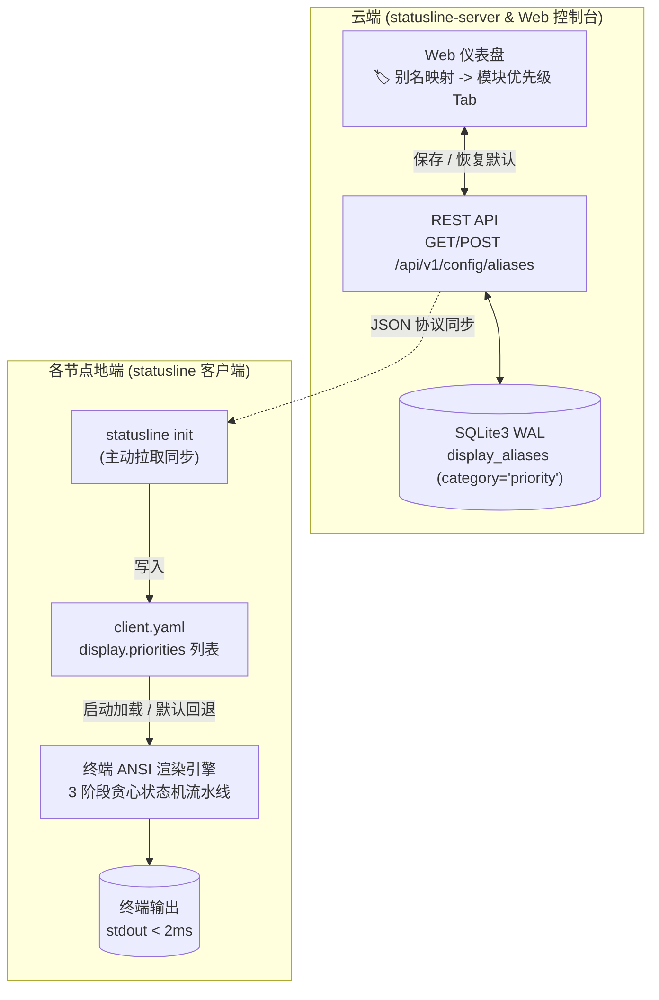

# 基于优先级的细粒度渐进式优雅降级排版与云端配置同步系统设计规范

- **日期**：2026-11-15
- **状态**：已批准 (Approved)
- **目标组件**：`statusline`（客户端插件）、`statusline-server`（服务端与 Web 控制台）

---

## 1. 背景与痛点

在多平台终端使用 AI 命令行助手（如 Google Antigravity `agy` 与 Anthropic Claude Code）时，终端窗口宽度变化频繁（如左右分屏、悬浮终端或窄屏笔记本）。
以往的 `statusline` 采用固定的粗粒度降级（Level 0 $\rightarrow$ Level 1 $\rightarrow$ Level 2 $\rightarrow$ Level 3）：
1. **降级粗暴**：只要状态行超出终端宽度哪怕 1 个字符，就会直接跳入下一 Level，导致多个模块同时被压缩或丢失；
2. **缺乏定制能力**：无法根据用户偏好决定保留哪些关键指标。某些开发者重视模型身份与推理深度，某些更关注配额余量与倒计时；
3. **缺少云端编排能力**：多台设备与节点之间的排版偏好无法统一由服务端下发和同步。

---

## 2. 系统架构设计



---

## 3. 数据模型与存储设计

### 3.1 数据库持久化 (`display_aliases` 表复用)
复用已有的 SQLite `display_aliases` 表，零新增数据表，零破坏性变更：
- `category`: 固定为 `'priority'`
- `alias_key`: 模块名称键，涵盖 7 个核心模块：`model`、`context`、`quota`、`vcs`、`tokens`、`account`、`dir`
- `display_name`: 模块友好展示名称（如 `模型标识与推理深度`、`上下文进度条与百分比`）
- `short_name`: 留空或辅助短标
- `sort_order`: **优先级权重值（1 ~ 7）**。
  - **数值越小，优先级越高**（第 1 位受最高保护，最晚被降级/隐藏）；
  - **数值越大，优先级越低**（第 7 位最不重要，空间不足时最先被缩短/裁剪）。

### 3.2 系统内置默认优先级 (Default Priorities)
若云端数据库尚无记录或地端离线时，系统内置常量默认优先级（高到低）：
1. `model` (权重 1 - 最高优先级，保留 AI 身份与推理深度)
2. `context` (权重 2 - 核心健康指标，当前窗口百分比)
3. `quota` (权重 3 - 核心额度信息，重置倒计时与剩余额度)
4. `vcs` (权重 4 - 代码上下文，Git 分支与脏标记)
5. `tokens` (权重 5 - 会话累计 Token 吞吐)
6. `account` (权重 6 - 登录账号身份)
7. `dir` (权重 7 - 最低优先级，工作区目录已知，最先压缩为 basename 或隐藏)

### 3.3 数据结构定义 (`internal/model/envelope.go`)
```go
type DisplayAliasesConfig struct {
    Quotas     []DisplayAliasItem `json:"quotas"`
    Models     []DisplayAliasItem `json:"models"`
    Accounts   []DisplayAliasItem `json:"accounts"`
    Priorities []DisplayAliasItem `json:"priorities"` // 按 sort_order 升序排列的优先级列表
}
```

---

## 4. 服务端与 Web 控制台设计

### 4.1 API 端点
- **`GET /api/v1/config/aliases`**：
  查询全部别名。在读取 `display_aliases` 时提取 `category = 'priority'` 记录。如果为空，则自动播种默认的 7 个模块并返回。
- **`POST /api/v1/config/aliases`**：
  批量 upsert 别名及模块优先级，支持事务化刷新 `sort_order`。

### 4.2 Web 仪表盘 (`cmd/statusline-server/web`)
1. **新增 Tab**：在「🏷️ 别名映射」弹窗新增第 4 个 Tab「⚡ 模块优先级 (Priorities)」。
2. **列表展示**：
   - `#1` 亮绿徽标（最高保护）、`#2 ~ #3` 绿色徽标、`#4 ~ #5` 黄色徽标、`#6 ~ #7` 橙色徽标（最先降级）；
   - 展示模块标识与中文说明；
   - 提供 `▲ 上移` 与 `▼ 下移` 操作按钮；
   - 顶部工具栏提供 **「↺ 恢复默认排序」** 按钮。
3. **即时保存与反馈**：
   - 调整顺序后自动触发 `POST /api/v1/config/aliases` 更新 SQLite；
   - 弹出 Toast 提示：`✔ 模块优先级已更新，客户端执行 statusline init 即可同步生效`。

---

## 5. 地端配置与自动同步

### 5.1 客户端配置规范 (`client.yaml`)
```yaml
display:
  enable_stdout: true
  segments:          # 终端显示的模块排版顺序（从左到右）
    - dir
    - vcs
    - account
    - model
    - context
    - tokens
    - quota
  # 模块优先级保护排序（由高到低）：排在前面的模块最受保护，排在后面的模块在屏幕空间不足时最先被缩略或隐藏
  priorities:
    - model
    - context
    - quota
    - vcs
    - tokens
    - account
    - dir
```

### 5.2 同步机制 (`statusline init`)
在 `internal/installer/init.go` 的 `SyncAliasesFromRemote` 中：
1. 请求服务端 `GET /api/v1/config/aliases`；
2. 提取 `remoteAliases.Priorities` 并更新本地 `client.yaml` 中的 `display.priorities`；
3. 输出提示：`✔ 成功从服务端同步别名与优先级映射并写入 client.yaml: X 个配额, Y 个模型, 7 项模块优先级`。

---

## 6. 渐进式优雅降级排版引擎 (`internal/render/layout.go`)

### 6.1 模块状态模型
每个激活模块拥有 4 种状态：
- **`StateFull` (常规展开)**：宽屏完整渲染；
- **`StateShort` (短名模式)**：
  - `dir`: 缩短为目录名 `[statusline]` (`FormatDirCompact`)；
  - `account`: 优先匹配别名 `short_name` 或 `display_name`，回退为邮箱前缀截断 (`formatAccountCompact`)；
  - `model`: 缩短为短名 `[Flash-H]` / `[Pro-H]` (`formatModelCompact`)；
  - `quota`: 供应商前缀缩写为 `G:` / `C:`，保留多窗口 (`formatQuotaCompact(data, true, false)`)；
- **`StateCompact` (结构紧凑模式)**：
  - `context`: 进度条由 8 斜杠变为 4 斜杠 `\\\\ 22% [1M]` (`formatContextCompact`)；
  - `quota`: 进一步压缩为单窗口 `G: 87%(4h)` (`formatQuotaCompact(data, true, true)`)；
- **`StateHidden` (完全隐藏)**：该模块不输出。

### 6.2 3 阶段贪心降级算法
```text
输入：StatusLineData (含 TerminalWidth), segments 切片, priorities 列表
1. 构建降级候选队列 DegradeQueue = Reverse(priorities ∩ segments)
2. 初始所有可用模块状态为 StateFull
3. 若 len(StripANSI(line)) <= TerminalWidth，立即返回完整行。

【Phase 1: 渐进短名替换】
for module in DegradeQueue:
    if module 支持短名化:
        state[module] = StateShort
        重新拼接 line
        if len(StripANSI(line)) <= TerminalWidth:
            return line

【Phase 2: 渐进结构紧凑】
for module in DegradeQueue:
    if module 具备结构紧凑态 (context, quota):
        state[module] = StateCompact
        重新拼接 line
        if len(StripANSI(line)) <= TerminalWidth:
            return line

【Phase 3: 渐进隐藏剪裁】
for module in DegradeQueue:
    if 剩余可见模块数 > 1:
        state[module] = StateHidden
        重新拼接 line
        if len(StripANSI(line)) <= TerminalWidth:
            return line

4. 返回最终保底 line (保证至少有最高优先级的单个核心模块可见)
```

### 6.3 管道符分隔规则
- 仅在非空且可见模块之间自适应插入管道符 `|`；
- 避免孤立管道符或连续管道符。

---

## 7. 质量与验证方案

1. **单元测试矩阵 (`render_test.go`)**：
   - 宽屏（140 字符）：100% 验证所有模块以 StateFull 输出；
   - 中等宽度（100 字符）：验证仅低优先级模块（如 `dir`, `account`）转为 ShortName，高优先级模块（如 `model`）仍保持 Full；
   - 窄屏（75 字符）：验证触发 Phase 2，`context` 压缩为 4 斜杠，`quota` 压缩为单窗口；
   - 超窄屏（50 字符）：验证触发 Phase 3，低优先级模块逐步隐藏，保留核心 `model`、`context`；
   - 自定义优先级测试：颠倒优先级顺序（将 `dir` 设为最高），验证在空间不足时 `dir` 受到严格保护，其他模块先被降级隐藏。
2. **端到端集成测试**：
   - `statusline-server` 接口测试：测试 `GET /api/v1/config/aliases` 自动下发优先级，`POST` 成功保存；
   - `statusline init` 测试：测试远程优先级同步并持久化到本地 `client.yaml`；
   - 渲染性能基准测试：确保整体渲染评估时间严格维持在 $< 0.1\text{ms}$（远低于 $<2\text{ms}$ 限制）。
