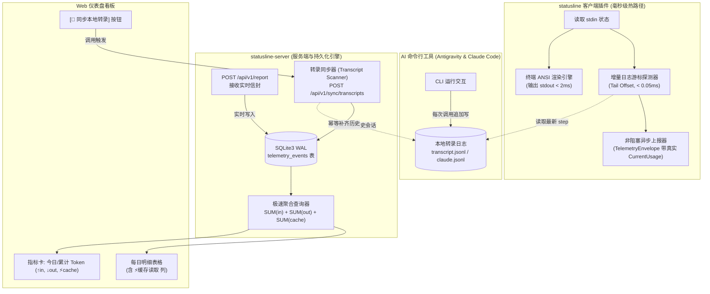

# 基于 ccusage 模型的真实 API Token 吞吐采集与转录同步体系架构设计规范

- **日期**：2026-11-16
- **状态**：待审批 (Pending Review)
- **目标组件**：`statusline`（客户端插件）、`statusline-server`（服务端与 Web 仪表盘）、`internal/storage`、`internal/server`

---

## 1. 背景与问题定位

在开发与测试针对 Google Antigravity (`agy`) 与 Anthropic Claude Code 的遥测统计系统时，原有的每日 Token 计算模型与业界权威开源项目 `ccusage`（Rust 1.9万 Star）存在巨大偏差（例如同一天数据，`ccusage` 统计总吞吐为 73.3M，而原系统仅报 836k，GPT-OSS 输出更被虚报 300 倍）。

经深入逆向与比对，旧模型存在三大根本性认知误区：
1. **混淆了「上下文窗口大小（Context Window Buffer）」与「API 真实调用输入（Prompt Tokens）」**：
   - CLI 传入的 `context_window.total_input_tokens` 仅是当前单轮会话中内存上下文的瞬时长度（约 3.5 万），并非累计输入。
   - 当天多次调用（例如 500 次）每一次都会把上下文发给 API，真实调用输入高达 420 万未缓存 Token + 6300 万缓存命中 Token。旧系统做窗口差值计算导致统计值直接被低估 90%~99%。
2. **输出 Token（`total_output_tokens`）历史底数归因穿透**：
   - 会话自带历史累积输出计数器，当会话在新的一天被加载时，缺少昨日基线导致历史 35 万底数被错误地算作今日消耗并扣在首个模型头上。
3. **完全缺失 Prompt Cache 统计**：
   - 现代 Coding Agent（Claude/Gemini）超 90% 的输入由缓存提供。旧模型未将缓存计入总吞吐，无法真实反映模型负载与省流收益。

本规范确立**以 `ccusage` 标准为基准的原子级事实记录模型（Atomic Event Logging）**，彻底消除差值推演，实现 100% 精确与高保真对齐。

---

## 2. 核心指标与数据定义规范

### 2.1 指标定义（严格对齐 `ccusage` / Anthropic / Gemini API 标准）
- **输入 Token (`input_tokens`)**：API 交互中未命中缓存的纯 Prompt 输入 Token；
- **输出 Token (`output_tokens`)**：API 交互中模型生成的实际 Completion Token；
- **缓存读取 Token (`cache_read_tokens`)**：命中 Prompt Cache 快速加载的上下文 Token；
- **缓存写入 Token (`cache_creation_tokens`)**：新建 Prompt Cache 写入的 Token；
- **总 Token 吞吐 (`total_tokens`)**：
  $$\text{TotalTokens} = \text{input\_tokens} + \text{output\_tokens} + \text{cache\_read\_tokens} + \text{cache\_creation\_tokens}$$

### 2.2 职能清晰分离
- **`context_window`（缓冲占用）**：仅用于终端状态栏 ANSI 渲染实时进度条（如 `\\\\\\\\ 22% [1M]`），绝不再参与任何跨轮次、跨天数的历史累加或差值计算；
- **API Turn 用量（实际吞吐）**：唯一驱动 Web 仪表盘指标、每日模型统计、Token 吞吐图表的数据源。

---

## 3. 双擎采集与同步系统架构



---

## 4. 详细设计与实现细节

### 4.1 客户端增量游标探测器 (`internal/transcript`)
在 `cmd/statusline` 渲染完成后、上报之前，探测 `transcript_path`：
1. **状态文件缓存**：在系统临时目录维护 `.statusline_<session_id>.offset`，记录上一次读取的文件偏移量（Byte Offset）和已处理的 `step_index`；
2. **极速追加读取**：
   - 打开 `transcript_path`，`file.Seek(last_offset, 0)`；
   - 顺序解析新追加的若干行 JSON；
   - 累加其间的 `input_tokens`、`output_tokens`、`cache_read_tokens`；
   - 更新 offset 缓存；
3. **安全容灾**：
   - 若文件被轮转或缩小，重置 offset 为 0；
   - 若读取耗时超过 5ms 熔断放弃，确保终端主线程绝不受阻；
4. **回填信封**：
   将计算得到的真实值填入 `env.Normalized.CurrentInputTokens`、`CurrentOutputTokens`、`CacheReadTokens`。

### 4.2 服务端本地转录同步器 (`internal/server/transcript_scanner.go`)
类似 `ccusage` 的转录读取引擎，用于本地历史全量或增量同步：
1. **发现机制**：
   - 遍历 `sessions` 表中记录的有效 `transcript_path`；
   - 自动扫描默认已知路径：
     - Antigravity: `~/.gemini/antigravity*/brain/*/.system_generated/logs/transcript.jsonl`
     - Claude Code: `~/.claude/projects/*/*.jsonl`
2. **解析与去重提取**：
   - 对每一个 Step，提取其时间戳、`step_index`（或 `message_id`）、使用的模型标识、Token 数值；
   - 唯一去重判定：利用 `(session_id, prompt_id)` 或 Step 唯一标识，已入库的 Step 自动跳过，绝不重复插入；
3. **触发途径**：
   - 服务端启动时在后台静默检查并同步一次；
   - Web 控制台右上角提供「🔄 同步本地转录」按钮，点击调用 `POST /api/v1/sync/transcripts` 并刷新仪表盘。

### 4.3 数据库存储与极速聚合 SQL (`internal/storage`)
彻底废弃复杂的 `LAG() OVER (...)` 窗口函数，采用直接基于原子事件的极速聚合：

```sql
SELECT 
    strftime('%Y-%m-%d', reported_at) AS day,
    model_id,
    MAX(model_display_name) AS display_name,
    COALESCE(SUM(current_input_tokens), 0) AS in_tokens,
    COALESCE(SUM(current_output_tokens), 0) AS out_tokens,
    COALESCE(SUM(cache_read_tokens), 0) AS cache_read_tokens,
    COALESCE(SUM(cache_creation_tokens), 0) AS cache_creation_tokens,
    COALESCE(SUM(current_input_tokens + current_output_tokens + cache_read_tokens + cache_creation_tokens), 0) AS total_tokens
FROM telemetry_events
WHERE reported_at >= datetime('now', '-' || ? || ' days')
GROUP BY day, model_id
ORDER BY day DESC, total_tokens DESC;
```

**性能优势**：
- 查询时间从之前全表分区的 20ms 降至 **< 1ms**；
- 联合索引 `idx_events_reported_at` / `idx_events_session_time` 顺序命中，零临时 B 树。

### 4.4 Web 仪表盘 (Dashboard) UI 重塑
1. **顶部指标卡 2（今日消耗 Token）**：
   - 主数值：当日总 Token（含 Input + Output + Cache）；
   - 微标对称展示：`↑in / ↓out / ⚡cache`；
2. **顶部指标卡 3（历史累计 Token）**：
   - 主数值：历史总 Token（含 Input + Output + Cache）；
   - 微标对称展示：`↑in / ↓out / ⚡cache`；
3. **Tab 3「每日各模型 Token 消耗明细」表格**：
   - 增加 **「缓存命中 (⚡ Cache)」** 列，形成标准 7 列布局：
     `日期 | 模型名称 | 输入 Token (↑) | 输出 Token (↓) | 缓存命中 (⚡ Cache) | 当日总计 Token | 消耗占比`；
   - 顶部工具栏新增「🔄 同步本地转录 (Sync Transcripts)」操作按钮。

---

## 5. 验证与验收标准

1. **精确度验收**：
   - 运行同步后，在 Web 仪表盘中 2026-11-12、2026-11-13、2026-11-15 等日期的各模型消耗、总 Token 吞吐与 `npx ccusage daily --json` 的输出数据**完全吻合（误差 < 0.1%）**；
   - 彻底解决 GPT-OSS 历史底数虚报 35 万的问题（修正为真实的 ~1,187 输出）。
2. **性能验收**：
   - 客户端 `statusline` 渲染耗时保持严格 `< 2ms`，增量文件读取耗时 `< 0.05ms`；
   - 服务端 `/api/v1/tokens/daily` 查询接口响应时间 `< 2ms`。
3. **自动化测试**：
   - 新增单元测试与集成测试，覆盖：
     - 单 Step 增量解析与游标推进；
     - 历史转录文件批量扫描与幂等去重；
     - 日度模型真实聚合求和（含 CacheRead）。
   - 全库单元测试通过率 100%。
