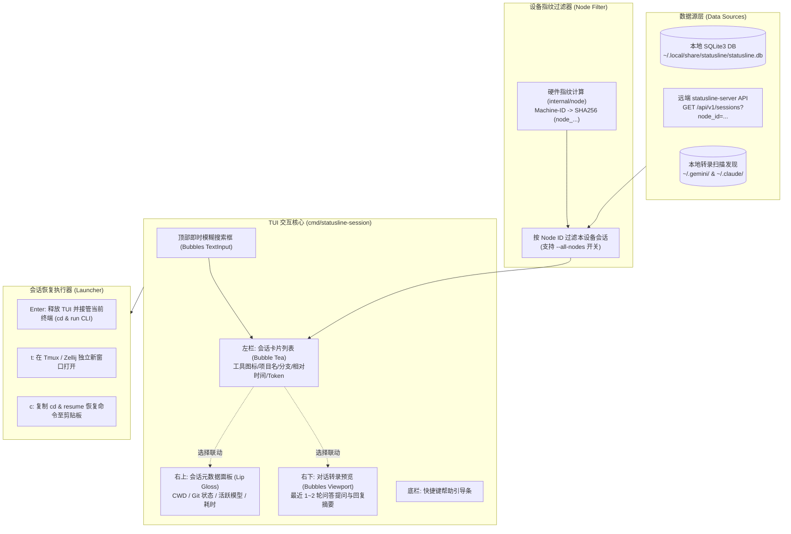

# statusline-session (sls): 独立 TUI 终端会话管理与快速恢复系统架构设计规范

- **日期**：2026-11-18
- **状态**：待审批 (Pending Review)
- **目标组件**：`cmd/statusline-session`（独立 TUI 客户端二进制，符号链接/别名 `sls`）、`internal/storage`、`internal/transcript`、`internal/node`

---

## 1. 背景与核心价值

在开发使用 Google Antigravity (`agy`) 与 Anthropic Claude Code (`claude`) 等 AI 命令行工具时，开发者通常会在多个项目仓库、不同的 Worktree 及 Git 分支之间频繁穿梭。伴随而来的核心痛点是：
1. **会话碎片化与上下文割裂**：终端窗口或 Tab 关闭后，过往会话深藏在各个项目的具体目录下，开发者难以全局掌握各个工具的历史活跃会话；
2. **恢复链路冗长繁琐**：想恢复某项未完成的任务时，需要先手动在文件系统中查找定位并 `cd` 到对应路径，再查找会话 ID 执行恢复命令；
3. **缺少上下文直观预览**：仅凭散落的会话 ID 很难回忆具体对话内容，容易挑错会话；
4. **多设备数据污染**：服务端数据库通常集中收集了来自多台物理机/虚拟机的会话，若不加过滤直接展示，在当前机器上根本无法定位或执行异地目录的会话。

本规范确立**独立高性能 TUI 终端会话管理器（`statusline-session` / `sls`）**的设计与实现。该模块基于 Go 生态主流的 **Bubble Tea + Lip Gloss** 现代声明式 TUI 架构，采用类 lazygit 的交互大盘形态，并严格**基于当前设备硬件指纹（Node ID）过滤本机会话**，提供极速模糊搜索、上下文转录高亮预览与一键恢复接管体验。

---

## 2. 核心架构与模块划分

---

## 3. 设备 ID 过滤机制规范 (Node ID Filtering)

### 3.1 默认过滤行为
1. 启动时自动通过 `node.GetNodeInfo(cfg.Node.ID, Version)` 计算当前机器的唯一硬件脱敏指纹 `CurrentNodeID`（如 `node_8f9d2a1b4c3e5f6a`）；
2. **数据源拉取过滤**：
   - 本地 SQLite 查询：`SELECT * FROM sessions WHERE node_id = ? ORDER BY last_active_at DESC`；
   - 远程服务端 API 查询：`GET /api/v1/sessions?node_id=<CurrentNodeID>`；
   - 保证左侧列表默认呈现的**全部为本物理机上真实存在、随时可恢复的会话**。

### 3.2 跨节点查看开关
- CLI 参数：`statusline-session --all-nodes` 或 `-a`；
- TUI 快捷键：按 `a` 可在「仅本设备会话 (Local Node)」与「全部跨设备会话 (All Nodes)」之间快速切换；
- 界面标识：当显示异地节点的会话时，卡片右上角显著标注 `[Node: node_xxxx...]`，且在该会话上按 `Enter` 时提示警告（`该会话位于其他设备，仅支持复制命令或查看预览`）。

---

## 4. TUI 界面与交互行为定义 (Bubble Tea + Lip Gloss)

### 4.1 终端布局规划 (响应式双栏)
- **最小终端宽度要求**：自适应 $\ge 80$ 列；在宽屏（$\ge 120$ 列）下按 `4:6` 黄金分割左右分栏；极端窄屏（$< 80$ 列）自动切换为全屏列表，按 `Tab` 键在「列表」与「详情预览」之间切换。
- **左侧会话列表卡片元素**：
  - 工具指示徽章：`[AGY]`（亮明青色 `\033[36m`）或 `[Claude]`（暖橙色 `\033[38;5;214m`）；
  - 项目标识：优先提取 Git 仓库名 `git_repo_name`，其次折叠工作目录 `cwd`；
  - Git 分支：浅薰衣草紫带脏状态标记（如 `(main*)`）；
  - 活跃时间与用量：相对时间（如 `5m ago`, `2h ago`, `3d ago`）与单会话吞吐（`↑12k ↓3k`）。
- **右侧详情与上下文预览**：
  - **右上卡片**：展示完整工作区路径 `cwd`（若目录在当前机器已不存在则标红 `(目录已移除)`）、会话 ID、完整模型名称、上下文使用百分比进度条；
  - **右下 Viewport**：按需极速读取该会话的 `transcript_path` 最后 2 轮问答。
    - 👤 **User**: 截取首行或前 3 行 Prompt 提问文本；
    - 🤖 **Assistant**: 截取模型生成的结论摘要（自动过滤无意义的空行与转义字符）。

### 4.2 快捷键映射规范
| 按键 | 动作 | 说明 |
|---|---|---|
| `↑` / `k` | 上移选择 | 移动游标并即时联动更新右侧详情与对话预览 |
| `↓` / `j` | 下移选择 | 移动游标并即时联动更新右侧详情与对话预览 |
| `/` | 激活搜索 | 焦点置于顶部输入框，支持拼音首字母/英文即时模糊过滤 |
| `Esc` | 取消搜索 / 返回列表 | 清空过滤词或退出搜索输入状态 |
| `Enter` | **直接接管恢复** | 退出 TUI 并接管当前终端执行会话恢复 |
| `t` | **Tmux 新窗口打开** | 若处于 tmux 环境中，自动新开独立 window 并跳转 |
| `c` | **复制恢复命令** | 将 `cd <cwd> && ...` 命令复制到系统剪贴板并提示反馈 |
| `a` | 切换设备过滤 | 在「当前设备」与「全部设备」之间切换 |
| `r` | 手动刷新 | 重新查询数据源与重载转录日志 |
| `d` | 归档/清理会话 | 标记或隐藏该会话（支持确认防误触） |
| `q` / `Ctrl+C` | 退出程序 | 干净恢复终端原始屏幕并退出 |

---

## 5. 会话恢复调度器 (Launcher) 规范

### 5.1 启动命令构造规则
针对不同工具生成对应的接管指令：
1. **Anthropic Claude Code (`claude_code`)**:
   - 若存在有效 `session_id`：`claude --resume <session_id>`
   - 若无特定 ID：`claude`
2. **Google Antigravity (`antigravity`)**:
   - 启动命令：`agy`（支持工作区上下文自动恢复）

### 5.2 终端接管流程
1. 用户选中会话并按下 `Enter`；
2. TUI 调用 `p.ReleaseTerminal()` 并退出 Bubble Tea 备用屏幕缓冲区（Alternate Screen Buffer），恢复终端原始状态；
3. 执行路径有效性校验：
   - 检查 `session.CWD` 是否存在；若不存在则输出友好错误提示并暂停，等待用户按任意键返回；
4. 进程接管：
   - **Unix/Linux/macOS**：执行 `syscall.Chdir(session.CWD)` 后，通过交互式 `exec.Command` 拉起工具并将 `os.Stdin`, `os.Stdout`, `os.Stderr` 完整接管；
   - **Windows**：切换工作目录后通过 `cmd.exe /c` 或 `powershell.exe` 原地启动 CLI；
5. CLI 进程结束退出后，干净返回用户常规终端。

---

## 6. 项目结构与编译构建

在现有 `scripts/build-release.sh` 与 Makefile/CI 中新增 `statusline-session` 产物构建：
- 二进制名称：`bin/statusline-session`（Windows 下为 `bin/statusline-session.exe`）；
- 跨平台支持：Linux (amd64/arm64)、macOS (amd64/arm64)、Windows (amd64)；
- 静态编译：`CGO_ENABLED=0`，零系统 C 依赖；
- 建议安装别名：在 `~/.bashrc` 或 `~/.zshrc` 中建立 `alias sls="statusline-session"`。

---

## 7. 实施计划分阶段规划 (Implementation Phases)

1. **Phase 1: 数据源适配与设备 ID 过滤层**：
   - 封装 `SessionService`，整合本地 SQLite 与服务端 API，注入 `node_id` 过滤机制；
   - 增加转录预览提取器（读取 `transcript_path` 尾部对话轮次）。
2. **Phase 2: Bubble Tea TUI 核心界面骨架与 Lip Gloss 样式**：
   - 实现响应式左右双栏布局模型与状态机（列表、详情、预览、搜索框、帮助栏）；
   - 实现键盘导航、即时模糊搜索过滤与设备筛选切换。
3. **Phase 3: Launcher 调度器与交互接管**：
   - 实现当前终端原生接管（`cd & exec`）、Tmux 窗口集成与剪贴板复制；
   - 处理路径缺失、CLI 命令未安装等异常边界。
4. **Phase 4: 单元测试、端到端集成与构建脚本整合**：
   - 编写 Bubble Tea 事件测试与数据过滤测试；
   - 更新 `scripts/build-release.sh` 与 `AGENTS.md`。
